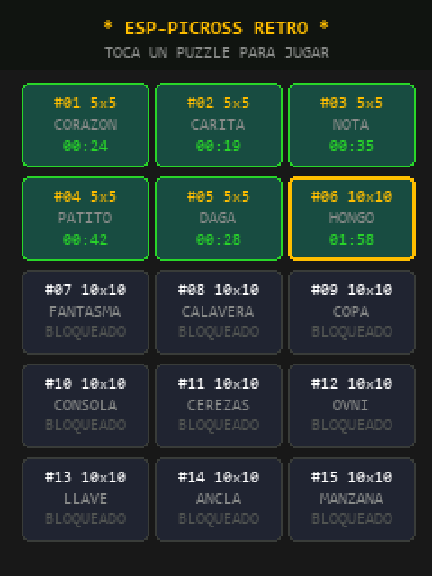
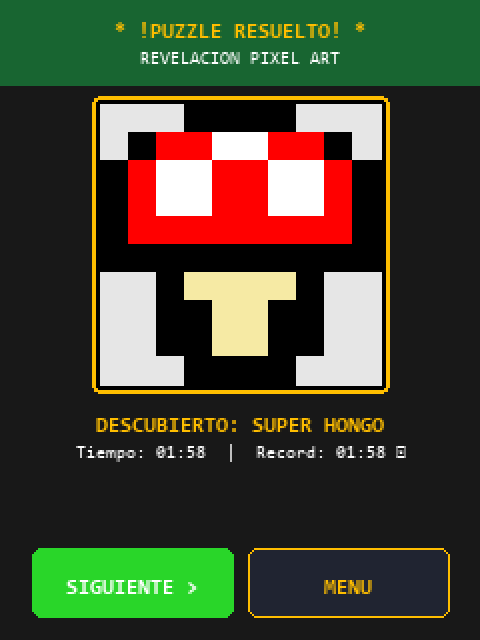

# ★ ESP32-Picross ★

[](https://platformio.org/)
[-blue?logo=espressif)](https://www.espressif.com/)
[](https://www.arduino.cc/)
[](https://github.com/lovyan03/LovyanGFX)
[](LICENSE)

Juego completo de **Picross / Nonogramas** estilo *Nintendo DS* para la placa **ESP32-2432S028** (conocida en la comunidad como **CYD** o *"Cheap Yellow Display"*). 

Diseñado específicamente para controlarse de forma táctil mediante **lápiz (*stylus*)**, ofreciendo una experiencia precisa, reactiva y retro sin necesidad de periféricos externos.

---

## 📸 Capturas de Pantalla

<div align="center">
  
  
  
</div>

---

## ✨ Características Destacadas

- ✏️ **Control Preciso con Lápiz Táctil (*Stylus*):**
  - **■ Modo Pintar:** Rellena píxeles o arrastra el lápiz para pintar líneas completas sin despegar el puntero.
  - **✕ Modo Cruzar:** Marca celdas descartadas con cruces rojas estilizadas.
  - **Arrastre Inteligente (*Smart Drag*):** Si inicias el trazo sobre una casilla vacía, rellena; si inicias sobre una casilla ya marcada, borra de forma continua.
- 💡 **Pistas con Auto-Atenuación (*Auto-Check*):**
  - Los números de pistas en filas y columnas se atenúan automáticamente a gris en cuanto la combinación de la línea se satisface correctamente.
- 🎨 **15 Puzzles Pixel Art Únicos:**
  - **Nivel Tutorial (5×5):** Corazón, Carita Sonriente, Nota Musical, Patito, Daga Retro.
  - **Nivel Clásico (10×10):** Super Hongo, Fantasmita Arcade, Calavera Pirata, Copa de Oro, Consola Retro (Game Boy), Cerezas, Ovni, Llave Dorada, Ancla, Manzana.
- 🌈 **Revelación a Color (*Victory Color Reveal*):**
  - Al completar un puzzle, desaparecen las líneas guía y el mosaico se transforma en una ilustración **pixel art a todo color (RGB565 de 16 bits)** en el centro de la pantalla.
- ⏱️ **Persistencia en Memoria Flash (NVS):**
  - Guarda automáticamente los niveles superados (estrella dorada ★) y tus récords de tiempo en minutos y segundos (`MM:SS`).
- 🔊 **Efectos de Sonido Retro (GPIO 26):**
  - Clics al pulsar, tonos de rellenado, marcas de descarte y fanfarria clásica al resolver el nivel (con botón de silencio `SND/MUT`).
- 💡 **Indicador LED RGB:**
  - Azul cian durante la partida, destellos amarillos al solicitar pistas y verde esmeralda al ganar.

---

## 🛠️ Especificaciones de Hardware (CYD ESP32-2432S028)

| Componente | Detalle Técnico | Asignación de Pines |
| :--- | :--- | :--- |
| **Microcontrolador** | ESP32 Dual-Core Xtensa LX6 @ 240 MHz | — |
| **Pantalla TFT** | 2.8" QVGA (240×320 px), ST7789 / ILI9341 | `SCLK:14`, `MOSI:13`, `CS:15`, `DC:2`, `BL:21` |
| **Panel Táctil** | Resistivo XPT2046 (Software SPI) | `SCLK:25`, `MOSI:32`, `MISO:39`, `CS:33` |
| **Audio** | Altavoz / Buzzer pasivo integrado | `GPIO 26` (LEDC Canal 0) |
| **LED RGB** | LED multicolor integrado (Active-LOW) | `R:4`, `G:16`, `B:17` |

---

## 📁 Estructura del Código

```text
esp32picross/
├── include/
│   ├── config.h            # Definición centralizada de pines, resolución y paleta RGB565
│   ├── hal/
│   │   ├── buzzer.h        # Rutinas de sonido y melodías con LEDC
│   │   ├── display.h       # Configuración acelerada de LovyanGFX
│   │   └── led.h           # Control de estados del LED RGB (Active-LOW)
│   ├── game/
│   │   ├── picross_game.h  # Máquina de estados, arrastre táctil y reglas de Picross
│   │   ├── puzzle_data.h   # Estructuras de datos de los 15 puzzles
│   │   └── storage.h       # Guardado de progreso y récords en NVS Preferences
│   └── ui/
│       └── renderer.h      # Motor gráfico, dibujado de cuadrícula y pantalla de victoria
├── src/
│   ├── hal/                # Implementaciones de drivers de hardware
│   ├── game/               # Implementaciones de lógica y base de datos de puzzles
│   ├── ui/                 # Implementación del renderizador
│   └── main.cpp            # Inicialización y bucle de eventos táctiles
├── platformio.ini          # Configuración del entorno de compilación
├── .gitignore              # Filtros de ficheros de compilación y temporales
└── README.md               # Esta documentación
```

---

## 🚀 Compilación y Carga en la Placa

Este proyecto está preparado para compilarse y flashearse directamente mediante **[PlatformIO](https://platformio.org/)**.

### Desde la Línea de Comandos (CLI):

```bash
# 1. Clonar el repositorio
git clone https://github.com/jgferrer/esp32picross.git
cd esp32picross

# 2. Compilar el proyecto
pio run

# 3. Flashear a la placa por USB
pio run -t upload

# 4. Monitor Serie para depuración (115200 baudios)
pio run -t monitor
```

### Desde VS Code:
1. Abre la carpeta del proyecto en VS Code con la extensión **PlatformIO IDE** instalada.
2. Haz clic en el icono de **PlatformIO** en la barra lateral.
3. Pulsa **Build** para verificar la compilación y **Upload** con la placa conectada por USB.

---

## 📜 Licencia

Distribuido bajo la Licencia **MIT**. Consulta el archivo `LICENSE` para más detalles.
